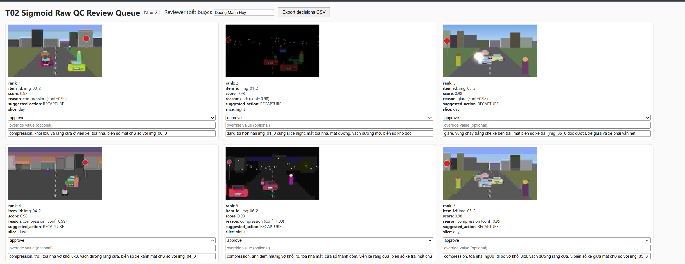
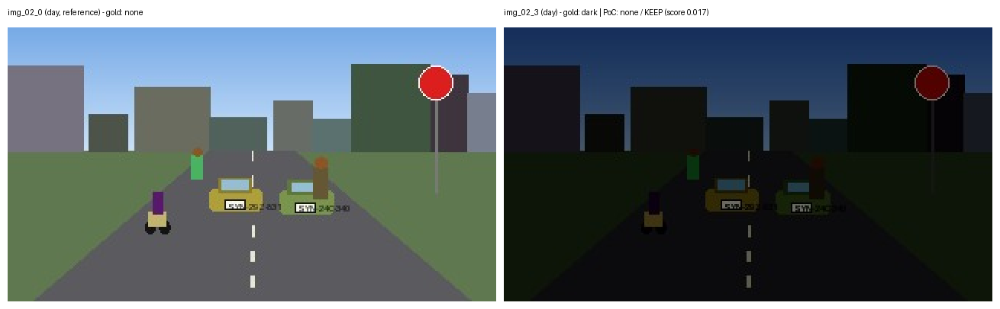

## 1 · Vấn đề — T02 Raw QC Triage

- 96 ảnh dashcam synthetic (CC0) · 2 camera (cam_A; cam_B quang học mềm) · day / dusk / night
- Split theo cảnh gốc: dev 56 ảnh (14 cảnh) · eval 40 ảnh (10 cảnh)
- Lỗi cần bắt: **blur · dark · glare · compression** → chụp lại (RECAPTURE) hay giữ (KEEP)
- Người review chỉ xem được **20 ảnh** → phải xếp ảnh lỗi lên đầu
- Metric chính: **Defect Recall@20** trên eval (giảng viên chấm bằng GT ẩn)
- Baseline đề bài: một ngưỡng Laplacian toàn ảnh → báo nhầm cam_B và ảnh đêm, bỏ sót lóa cục bộ

---

## 2 · Pipeline 5 bước — một lệnh, offline, seed 42

`python -m src.main --track t02 --output out/poc --offline --seed 42`

| Bước | Làm gì |
|---|---|
| load | kiểm sha256 theo `manifest.csv`, đọc `images.csv` |
| process | 4 xác suất lỗi (sigmoid): blur theo camera · dark / glare theo ngữ cảnh đêm · blockiness 8×8 → RECAPTURE khi max ≥ 0.25 |
| rank | top-20 theo `score` → `review_queue.csv` + `contact_sheet.html` |
| review | đọc quyết định người review → override `pred_action` → `audit_log.jsonl` |
| decide | > 20% ảnh RECAPTURE: HOLD (chưa review) / REWORK (đã review); ≤ 20%: GO · kèm `reason_code` + `owner` |

- Tham số đóng băng trong `configs/lab.yaml` trước review và eval (commit `ba5b2c2`)
- 96 ảnh trong 0.25 s (≈ 2.7 ms/ảnh, CPU) · `pytest` 0 failed

---

## 3 · Baseline vs PoC — tự đánh giá trên dev

56 ảnh dev, nhãn nhóm tự gán (28 lỗi / 28 sạch), B = 28 (50% như eval) · `reports/ablation.md`

| Run | Recall@28 | Wilson 95% CI | Ảnh sạch bị gắn RECAPTURE |
|---|---|---|---|
| Random | 0.500 | 0.33–0.67 | — |
| Baseline Laplacian | 0.821 | 0.64–0.92 | 3 (đều cam_B) |
| **PoC sigmoid** | **0.893** | 0.73–0.96 | 2 (dusk) |

- PoC cải thiện 3 failure mode của baseline trên dev: glare 1/4 → 4/4 · cam_B sạch bị báo nhầm 3 → 1 · night sạch lọt top 0.5 → 0
- Ablation: nhánh blur đóng góp nhiều nhất (bỏ đi: 0.893 → 0.750); nhánh compression gây cả 2 false alarm
- Không phải metric chính thức; CI chồng lấn → chưa khẳng định PoC hơn baseline có ý nghĩa thống kê

---

## 4 · Human review & quyết định

- Reviewer Duong Manh Huy: 20/20 ảnh so với ảnh gốc cùng cảnh, ghi note cho từng ảnh
- **20 approve, 0 override** → top-20 không có false alarm theo reviewer (20/20, Wilson 95% CI 0.84–1.00)
- Batch: **HOLD → REWORK / RECAPTURE_REQUIRED** (46/96 = 47.9% > 20%) · owner: Nguyen Thai Duc (Lead)
- Review không đổi `score` → không đổi metric · đường override (`reject` / `edit` → audit log) được kiểm bằng test

---

## 5 · Failure cases & giới hạn

1. **Ảnh ngày thiếu sáng bị coi là ảnh đêm** → bỏ sót 4/6 ảnh `dark` trên dev (điều kiện tự nhận đêm ghi đè `light = day`)
2. **Ảnh hoàng hôn sạch bị báo `compression`**: trời chuyển màu đẩy blockiness lên 1.51–1.55, sát tâm 1.65 (`demo/failure_case_2.png`)

- PoC gắn RECAPTURE 47.9% ảnh → batch luôn REWORK; review chỉ phủ top-20, 26 ảnh RECAPTURE còn lại chưa có người xem
- Gold set dev: một người duyệt, chưa đo đồng thuận · night trên dev chỉ 4 ảnh
- Dữ liệu synthetic; dùng ảnh thật cần đánh giá lại quyền riêng tư và license — nhóm không tuyên bố đạt GDPR / luật Việt Nam
