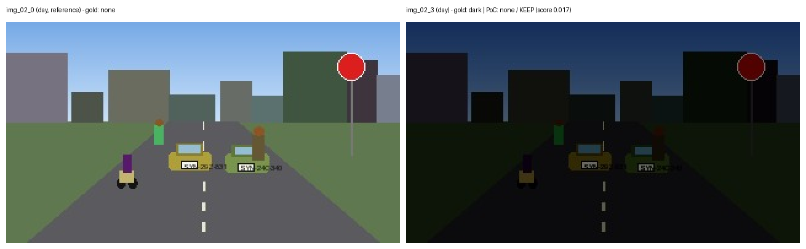
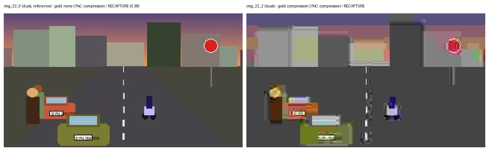

# Failure cases — PoC T02 (commit freeze `ba5b2c2`)

Nguồn: so sánh `out/poc/ranked_review.csv` với `reports/gold_set_dev.csv` trên 56 ảnh `dev`
(`reports/ablation.md`). PoC sai 6/56 ảnh ở hành động KEEP/RECAPTURE: 4 ảnh lỗi bị bỏ sót, 2 ảnh sạch bị báo nhầm.
Hai failure case dưới đây gom đúng hai nhóm sai đó. Đặc trưng được đo bằng chính các hàm trong `src/pipeline.py`
(ảnh chuẩn hoá cạnh dài ≤ 360 px, ảnh xám).

## Failure case 1 — Ảnh ban ngày thiếu sáng bị coi là ảnh đêm → bỏ sót lỗi `dark`

| Ảnh | `light` | Gold | PoC | `mean` | `dark_frac` | Tự nhận đêm | `dark_sev` |
|---|---|---|---|---|---|---|---|
| `img_02_0` (mốc) | day | none | none / KEEP | 117.9 | 0.00 | không | −88.9 |
| `img_02_3` | day | dark | **none / KEEP** (score 0.017) | 23.9 | 0.74 | **có** | −9.6 |
| `img_07_2` | day | dark | **none / KEEP** | 26.0 | 0.65 | **có** | −13.0 |
| `img_10_3` | day | dark | **none / KEEP** | 24.5 | 0.66 | **có** | −10.6 |
| `img_20_2` | day | dark | **none / KEEP** | 23.4 | 0.73 | **có** | −8.7 |
| `img_17_3` (eval, để so sánh) | day | — | dark / RECAPTURE | 5.5 | 0.99 | có | 17.2 |

- **Hiện tượng:** ảnh ban ngày bị thiếu sáng rõ (mất màu trời, tòa nhà và người đi bộ gần như chìm vào nền; biển số
  vẫn đọc được) nhưng PoC chấm sạch.
- **Root cause:** `process()` coi ảnh là ảnh đêm khi `light == "night"` **hoặc** `dark_frac > 0.60 và mean < 35`.
  Điều kiện thứ hai ghi đè metadata `light = day`: ảnh ngày thiếu sáng (mean ≈ 24) bị đánh giá theo công thức ảnh đêm
  với mốc `dark_mean_night = 14`, nên `dark_sev` âm và xác suất `dark` gần 0. Chỉ ảnh gần như đen hẳn
  (mean ≈ 5, như `img_17_3`) mới vượt ngưỡng. Ablation xác nhận: bỏ nhánh dark không làm đổi Recall@28 trên dev.
- **Hậu quả:** ảnh thiếu sáng vừa phải — loại hay gặp nhất khi phơi sáng sai — lọt vào tập huấn luyện. Recall `dark`
  trên dev 3/6 (baseline Laplacian 6/6).
- **Hướng sửa (chưa áp dụng, tham số đã đóng băng):** chỉ tự nhận đêm khi `light` không có trong metadata; với ảnh có
  `light`, so độ sáng với mức bình thường của chính slice đó. Phải kiểm lại trên dev trước khi dùng.

## Failure case 2 — Ảnh hoàng hôn sạch bị báo `compression`

| Ảnh | `light` | Gold | PoC | blockiness 8×8 | xác suất compression |
|---|---|---|---|---|---|
| `img_22_0` | dusk | none | **compression / RECAPTURE** (0.38) | 1.552 | 0.38 |
| `img_12_0` (cam_B) | dusk | none | **compression / RECAPTURE** (0.33) | 1.507 | 0.33 |
| `img_04_0` | dusk | none | none / KEEP | 1.137 | ≈ 0 |
| `img_08_2` | dusk | compression (nhẹ) | compression / RECAPTURE | 1.696 | ≥ 0.5 |
| `img_22_2` | dusk | compression | compression / RECAPTURE | 2.752 | ≈ 1 |

- **Hiện tượng:** ảnh mốc hoàng hôn, nét và không có khối 8×8 nhìn thấy được, bị đề xuất chụp lại.
- **Root cause:** độ đo blockiness so độ chênh tại biên khối 8×8 với độ chênh trung bình. Ảnh hoàng hôn có trời
  chuyển màu và nhiều mảng phẳng, nên tỉ lệ này cao tự nhiên (1.51–1.55) và nằm sát tâm sigmoid `comp_center = 1.65`.
  Vì `flag_threshold = 0.25` thấp hơn điểm giữa sigmoid (0.5), mọi ảnh có blockiness trong khoảng ~0.2 dưới tâm
  đều bị gắn RECAPTURE. Trên dev, 10 ảnh nén thật có blockiness 1.70–2.75 và 28 ảnh sạch ≤ 1.55; khoảng trống giữa
  ảnh sạch cao nhất (1.552) và ảnh nén nhẹ nhất (`img_08_2`, 1.696) chỉ ~0.14, và cả hai ảnh sạch cao nhất đều là ảnh dusk.
- **Hậu quả:** chụp lại không cần thiết (false alarm 2/28 ảnh sạch trên dev); ablation cho thấy bỏ nhánh compression
  thì hết báo nhầm nhưng mất 4/10 ảnh nén thật.
- **Hướng sửa (chưa áp dụng):** đo blockiness tương đối so với ảnh mốc cùng điều kiện ánh sáng, hoặc chỉ đo trên vùng có
  cạnh/kết cấu (bỏ vùng trời phẳng). Phải kiểm lại trên dev trước khi dùng.

## Ghi chú

- Cả hai ca thuộc ngoài top-20 review (`reports/review_policy.md` §6): người review chỉ thấy 20 ảnh có `score` cao nhất,
  nên không phát hiện được ảnh bị bỏ sót (ca 1) và các false alarm có `score` thấp (ca 2).
- Kết quả trên `eval` không được dùng để chọn hay mô tả các ca này.
